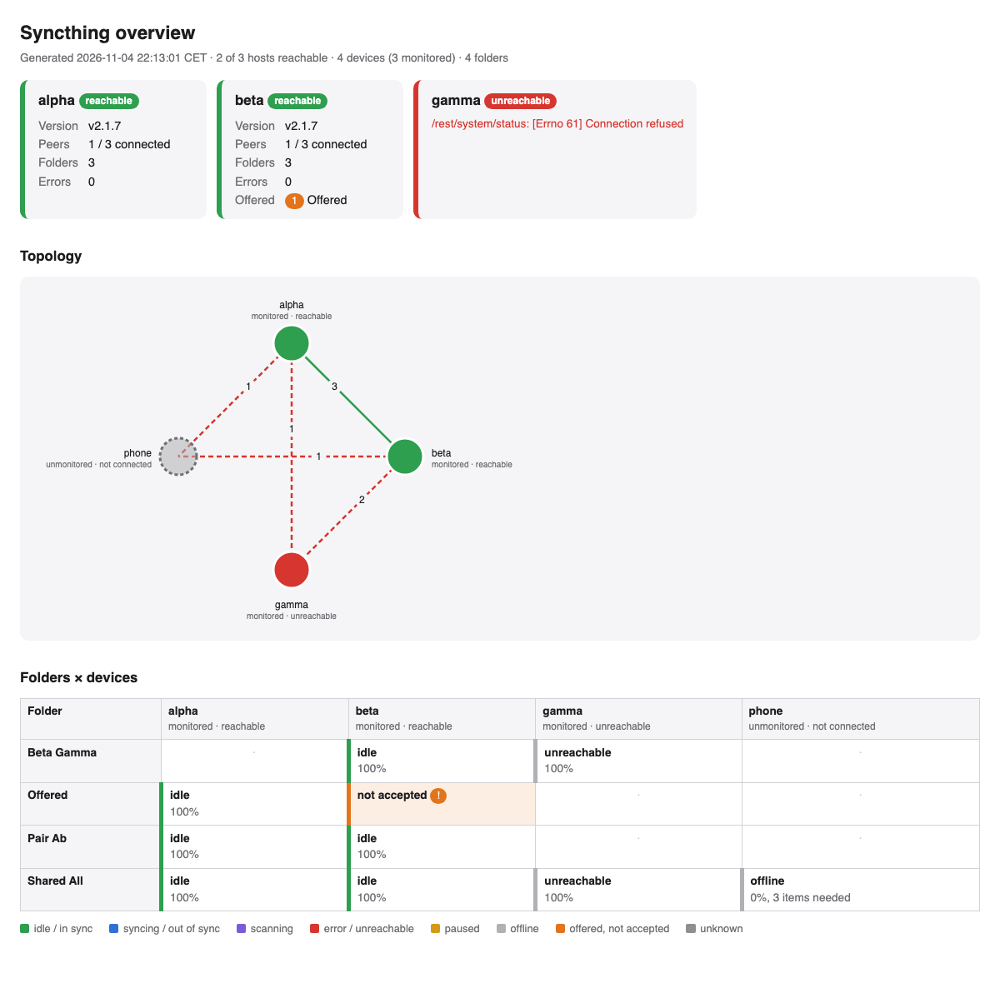

# syncthing-dashboard

One self-contained HTML page with the topology and sync status of all your
[Syncthing](https://syncthing.net) instances: a host strip, a graph of which
devices share folders with which, and a folder × device matrix with the sync
state of every copy.

Every Syncthing instance has its own GUI; none shows the whole network. This
tool polls each instance's REST API and merges the answers into one page.

- **Python 3.11+, standard library only.** No pip dependencies; runs as a
  script, from cron, or in a minimal container.
- **Secrets only via files.** API keys are read from files, never from the
  configuration or the environment, and never appear in the page or the logs.
- **No JavaScript, no CDN.** Inline CSS and inline SVG; hover texts come from
  `<title>` elements.



## What the page shows

- **Host strip** — one card per configured host: reachable or not, version,
  connected peers, number of folders, errors, and folders that were offered to
  it but not accepted. The host name links to its Syncthing GUI.
- **Topology** — devices as nodes coloured by status (green reachable or
  connected, red unreachable, grey not connected, yellow paused; unmonitored
  devices have a dashed outline), an edge where a host shares at least one
  folder with another device; the edge label is the number of folders, the
  colour the connection state. Hover an edge for the folder names, a node for
  its device ID and version.
- **Folders × devices** — rows are folders, columns are devices (monitored
  ones link to their GUI). A cell shows the state (idle, syncing, scanning,
  error, paused, out of sync), completion percent and items still needed. A
  folder **offered to a monitored host that has not accepted it** is flagged
  orange.

The links open the Syncthing GUI's own login. The API key cannot log a browser
in: Syncthing accepts it only in a request header (`X-API-Key` or
`Authorization: Bearer`), which a link cannot carry.

Devices that appear in a host's configuration but are not in `hosts.toml`
(phones, tablets, guests) are shown as *unmonitored* nodes with the state the
monitored hosts report about them. An unreachable host is shown as such and
never breaks the page; its cells show what its peers last knew about it.

## Set-up

1. Find the API key of each instance: Syncthing GUI › *Actions* › *Settings* ›
   *General* › *API Key*.
2. Write each key into its own file, one line, readable only by the user that
   runs the dashboard:

   ```sh
   mkdir -p secrets && chmod 700 secrets
   printf '%s\n' 'the-api-key-of-nas' > secrets/syncthing_nas
   chmod 600 secrets/*
   ```

3. Copy `hosts.example.toml` to `hosts.toml` and list your hosts:

   ```toml
   [[hosts]]
   name = "nas"
   url = "https://nas.example.internal:8384"
   api_key_file = "secrets/syncthing_nas"
   ca_file = "/etc/ssl/certs/private-ca.pem"   # optional, for a private CA

   [[hosts]]
   name = "laptop"
   url = "http://192.0.2.10:8384"
   api_key_file = "secrets/syncthing_laptop"
   ```

   `name` is the label on the page. When a host is unreachable, the dashboard
   finds its device ID by looking for a device with the same name in the other
   hosts' configurations, so name the device the same way on its peers.
   Relative paths are resolved against the location of `hosts.toml`.

4. Render once, or serve:

   ```sh
   python3 -m syncthing_dashboard --out overview.html          # for cron
   python3 -m syncthing_dashboard --serve 8080                 # regenerates on every request
   ```

   `--serve` adds a meta refresh of 30 s (`--refresh 0` disables it) and
   answers `/healthz` with `ok`. Other options: `--config`, `--bind`,
   `--timeout` (seconds per REST call, default 5), `--title`, `--verbose`.

`hosts.toml`, `*.pem` and `secrets/` are in `.gitignore`.

### Secret file layout

The `api_key_file` convention matches what container and service managers
provide, so the same `hosts.toml` works in all three set-ups:

| Where it runs        | Key file                                   |
| -------------------- | ------------------------------------------ |
| plain                | any file, e.g. `secrets/syncthing_nas`     |
| Docker Compose       | `/run/secrets/<secret name>`               |
| systemd (`LoadCredential=`) | `/run/credentials/<unit>/<name>`     |

### HTTPS GUIs with a private CA

Set `ca_file` to the PEM bundle of the CA that signed the GUI certificate.
Without `ca_file` the system trust store is used. There is deliberately no
option to skip verification.

### Troubleshooting

- **`HTTP 403 Forbidden`** — wrong API key, or Syncthing's host check: a GUI
  bound to `127.0.0.1` rejects requests whose `Host` header is anything else
  (DNS-rebinding protection). Use the address Syncthing listens on, or set
  *Settings › GUI › Skip host check* (`insecureSkipHostcheck`) on that
  instance.
- **`TLS verification failed`** — the GUI certificate is not signed by a CA in
  the system store; set `ca_file`.
- **A host is unreachable but its device does not appear** — the page says so
  in a yellow box. Give the device the same name as the host on one of its
  peers.

## Container

The image `ghcr.io/finestream/syncthing-dashboard` is built by GitHub Actions
(`.github/workflows/ci.yml`) for `linux/amd64` and `linux/arm64`: `latest`
follows `main`, a tag `v1.2.3` publishes `1.2.3`, `1.2` and `1`, and every
build also gets a `sha-…` tag. It runs `--serve 8080` as an unprivileged user
on `python:3.13-alpine`; `docker build .` builds the same image locally.

`compose.yaml` is an example stack that mounts `hosts.toml` read-only and
passes the API keys as compose secrets:

```yaml
services:
  syncthing-dashboard:
    image: ghcr.io/finestream/syncthing-dashboard:latest
    ports: ["8080:8080"]
    volumes:
      - ./hosts.toml:/config/hosts.toml:ro
    secrets: [syncthing_nas, syncthing_laptop]

secrets:
  syncthing_nas:
    file: ./secrets/syncthing_nas
  syncthing_laptop:
    file: ./secrets/syncthing_laptop
```

With this layout `hosts.toml` uses `api_key_file = "/run/secrets/syncthing_nas"`.

```sh
docker compose up -d
```

## How it works

Per host, with a timeout and in parallel across hosts:

| Endpoint                                 | Used for                                   |
| ---------------------------------------- | ------------------------------------------ |
| `/rest/system/status`                    | own device ID                              |
| `/rest/system/version`                   | version                                    |
| `/rest/config`                           | folders with their devices, device names   |
| `/rest/system/connections`               | connected peers, connection state          |
| `/rest/system/error`                     | error count                                |
| `/rest/cluster/pending/folders`          | folders offered to this host, not accepted |
| `/rest/db/status?folder=`                | local state of each folder                 |
| `/rest/db/completion?folder=&device=`    | what this host knows about each remote copy|

Device IDs are the identity across hosts. For a monitored, reachable host the
matrix cell is its own folder status; for everything else (unmonitored devices,
unreachable hosts) it is the best report from a reachable host that shares the
folder, preferring hosts that are connected to the device.

## Tests

Unit tests run without Syncthing:

```sh
python3 -m unittest discover -s tests -t .
```

The live test needs the `syncthing` binary. The harness starts three
instances on `127.0.0.1` (GUI ports 28384–28386, sync ports 32200–32202,
overridable with `SYNCTHING_TEST_GUI_PORT` and `SYNCTHING_TEST_SYNC_PORT`),
shares folders in different combinations, offers one folder that is not
accepted, adds a fourth device that is never started, and stops one
instance:

```sh
python3 -m tests.live.harness up        # start and configure the network
python3 -m unittest tests.test_live      # also writes tests/live/run/overview.html
python3 -m syncthing_dashboard -c tests/live/run/hosts.toml --serve 8080
python3 -m tests.live.harness clean      # stop and remove tests/live/run
```

Everything lives under `tests/live/run/`, which is ignored by git. Discovery,
relays and NAT traversal are disabled on the test instances.

## Licence

MIT, see `LICENSE`.
